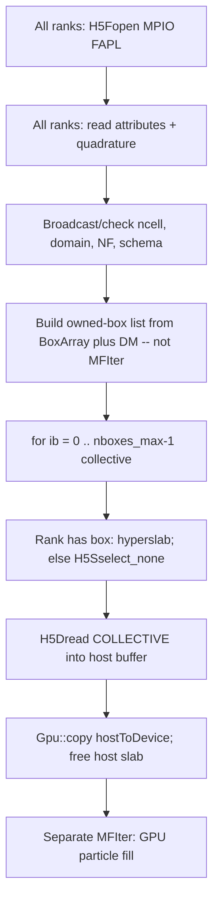

# Spatially Dependent Neutrino ICs via Shared HDF5 + MPI-IO

## 1. Verified initialization path

Fresh runs do **not** construct a physical distribution in C++. They load one angular×energy **template** and replicate it on every cell.

```217:237:Source/main.cpp
    if (parms->do_restart) {
        RecoverParticles(...);
    } else {
        neutrinos_old.InitParticles(parms);
    }
```

`InitParticles` ([Source/FlavoredNeutrinoContainerInit.cpp](Source/FlavoredNeutrinoContainerInit.cpp) 162–532):

1. **Once per rank:** `read_particle_data(particle_data_filename)` reads ASCII `particle_input.dat` into a `Gpu::ManagedVector<GpuArray<Real, PIdx::nattribs>>` (36–107).
2. Header line 1 must match compile-time `NUM_FLAVORS`. Lines 2–3 (`n_directions`, `n_energies`) are **skipped**. Row count becomes `ndirs_per_loc`.
3. **Per owned tile** (`MakeMFIter`): count in-domain `nppc` sites, `Gpu::inclusive_scan`, `particle_tile.resize`, `ParticleType::NextID()` / `NextID(new_pid+num_to_add)` inside `#pragma omp critical` (239–259).
4. **Device:** `ParallelForRNG` over cells. For each of `nppc` sites × `ndirs_per_loc` template rows: copy the **same** template, set `pos` / integrated `(x,y,z,time)`, scale **diagonal** `N*` and `Vphase` by `V_cell / nlocs_per_cell`, optionally apply `perturbation_type` 0–3.
5. Global `ReduceMin` of `pupt` to set `Vvac_max` (523–531).

**No `Redistribute` after init.** Particles are born already on the owning tile. `copyParticles(..., true)` then skips redistribute ([Source/main.cpp](Source/main.cpp) 244–247). Hydro (`rho`, `T`, `Ye`) is filled later by `interpolate_hydro_to_particles` (249–252), not from the IC file.

### Particle layout (verified)

Container is SoA reals, no struct-attached reals/ints:

```135:136:Source/FlavoredNeutrinoContainer.H
class FlavoredNeutrinoContainer
    : public amrex::ParticleContainer<0, 0, PIdx::nattribs, 0>
```

Kernels use `FNParticleView` (`id()`, `cpu()`, `pos()`, `rdata(comp)`). IDs live in AMReX `idcpu`; `Particle<0,0>::NextID()` is the host counter (IDs start at 1, unique with `cpu`).

Fixed prefix then generated Hermitian pack ([Source/FlavoredNeutrinoContainer.H](Source/FlavoredNeutrinoContainer.H) 18–34 + [Source/generated_files/FlavoredNeutrinoContainer.H_fill](Source/generated_files/FlavoredNeutrinoContainer.H_fill)):

- `time, x, y, z` — integrated coordinates; init sets them equal to `pos` and `time=0`
- `pupx, pupy, pupz, pupt` — four-momentum in **erg**; `phat = pup / pupt` at deposit ([Source/Evolve.cpp](Source/Evolve.cpp) 580–583)
- `rho_g_inv_ccm, T_erg, Ye` — **not** read from IC; mesh-interpolated
- Packed upper-triangle `Nij_Re/Im` and `Nij_*bar` (2F: 4+4; 3F: 9+9)
- `TrHN` — typically 0 at IC; accumulated during RHS
- `Vphase` — file stores `dOmega * (E_hi^3 - E_lo^3)/3`; init multiplies by `V_cell / nppc`

Python writers ([Scripts/initial_conditions/initial_condition_tools.py](Scripts/initial_conditions/initial_condition_tools.py), [st5_minerbo.py](Scripts/initial_conditions/st5_minerbo.py), [st9_empty_particles_multi_energy.py](Scripts/initial_conditions/st9_empty_particles_multi_energy.py)):

- Directions from `uniform_sphere(nphi_equator)` (not a C++ input)
- `N_jj` per row is a **per-quadrature share of cell-averaged number density** (`cm^-3`)
- Multi-energy is just more rows; C++ does not distinguish energy from direction
- Moment reconstruction (`moment_interpolate_particles` + Minerbo/Levermore) is **offline Python only**

**Off-diagonal scaling quirk (verified):** only diagonals and `Vphase` are multiplied by `scale_fac` (348–372). Off-diagonals from the file are copied unscaled. Perturbation types 0/1 **overwrite** off-diagonals after diagonal scaling, so tests still work. Spatially varying coherences in HDF5 should scale **all** packed `N` components; leave the ASCII path unchanged.

### Spatial placement

`get_position_unit_cell` (113–126): sub-cell centers `(0.5+ix)/nppc`. Physical `x = p_lo + (i+r)*dx`. Sites on the domain hi face are skipped. Cell volume uses compile-time `ActiveMetric::vol` ([Source/Metric.H](Source/Metric.H) 817–825: Cartesian / cylindrical / spherical via `COORD_SYS`).

---

## 2. Build and HDF5 support (pinned AMReX)

| Item | Finding |
|------|---------|
| AMReX pin | `submodules/amrex` **`c4a2ddb18`** (`26.08-30-gc4a2ddb18`) |
| Build | GNU Make only ([Make.Emu](Make.Emu)); `USE_HDF5=TRUE` pulls AMReX `Make.hdf5` (`-DAMREX_USE_HDF5`, `-lhdf5`) |
| App mesh HDF5 | Raw C API, **`H5Fopen(..., H5P_DEFAULT)`**, full-dataset read, **no `H5Pset_fapl_mpio` in `Source/`** |
| Background IC | [Source/ReadHDF5RhoYeT.cpp](Source/ReadHDF5RhoYeT.cpp): **every rank** reads the whole file (`doIO=1`), then `MPI_Bcast`. C-order `(nx,ny,nz)` with `idx = k + nz*(j + ny*i)` ([Source/ReadInput_RhoTempYe.cpp](Source/ReadInput_RhoTempYe.cpp) 65) |
| Plot/restart HDF5 | **Compiled out:** `#undef AMREX_USE_HDF5` in [Source/IO.cpp](Source/IO.cpp) 5–7 and [Source/DataReducer.cpp](Source/DataReducer.cpp) 8–10 (CUDA plotfile errors) |
| HighFive | Submodule present, **not** in [Source/Make.package](Source/Make.package); DataReducer HighFive path is dead |
| AMReX MPI-IO | Unused by Emu, but **present** in this AMReX: `SetHDF5fapl` + `H5Pset_fapl_mpio` + `H5FD_MPIO_COLLECTIVE` + `H5Sselect_none` for empty ranks ([submodules/amrex/Src/Extern/HDF5/AMReX_PlotFileUtilHDF5.cpp](submodules/amrex/Src/Extern/HDF5/AMReX_PlotFileUtilHDF5.cpp) 110–117, 447–452, 769–777; [AMReX_ParticleHDF5.H](submodules/amrex/Src/Extern/HDF5/AMReX_ParticleHDF5.H) 918–938 dummy collective writes) |
| Frontier | [makefiles/GNUmakefile_frontier](makefiles/GNUmakefile_frontier): `USE_HDF5=TRUE`, `HDF5_HOME=$(HDF5_DIR)`, comments load `cray-hdf5-parallel` |
| Perlmutter | [makefiles/GNUmakefile_perlmutter_HDF5_CUDA](makefiles/GNUmakefile_perlmutter_HDF5_CUDA): `HDF5_HOME=/opt/cray/pe/hdf5-parallel/1.12.2.9/` |
| Local/CI | OpenMPI HDF5 path in [Exec/GNUmakefile](Exec/GNUmakefile); CI uses **serial** HDF5 + `USE_MPI=FALSE` ([.github/workflows/c-linter.yml](.github/workflows/c-linter.yml) 32–53) |

**Build changes required**

- Keep `USE_HDF5=TRUE` and MPI-enabled `HDF5_HOME` on Frontier/Perlmutter (already set).
- New reader must compile in three configurations: MPI+parallel HDF5 (HPC), MPI+serial HDF5 (possible local), no-MPI serial HDF5 (CI). Guard MPI-IO with `#if defined(AMREX_USE_MPI) && defined(H5_HAVE_PARALLEL)`.
- Do **not** enable AMReX plotfile HDF5 (leave the `#undef` in `IO.cpp`). Do **not** add HighFive to the particle IC path.
- Follow AMReX 1.8-style calls (`H5Fopen`/`H5Dopen2`/`H5Pset_fapl_mpio`) as in `AMReX_PlotFileUtilHDF5.cpp`, not the `H5_USE_16_API` macros in `ReadHDF5RhoYeT.cpp`.
- No makefile change is required for linking if `USE_HDF5=TRUE` already; add the new `.cpp` to [Source/Make.package](Source/Make.package). Document that `cray-hdf5` (serial) vs `cray-hdf5-parallel` is a silent runtime failure mode: detect missing `H5_HAVE_PARALLEL` at compile or abort if `particle_ic_mode=hdf5` and MPI-IO is unavailable.

GPU implication (verified in AMReX plot code ~720–722): HDF5 I/O is **host-side**. Do not pass device pointers to `H5Dread`. CUDA/HIP builds are fine if staging is pinned/host → `Gpu::copy`.

---

## 3. Recommended HDF5 schema (rank-independent)

One file, few large datasets, **global AMReX cell indices**, not boxes or ranks. Separate from checkpoints (`pltNNNNNNN/neutrinos`).

**Root attributes** (`emu_ic_schema_version = 1`):

- `num_flavors` (must equal `NUM_FLAVORS`)
- `hermitian_storage`: `"packed_upper"` (v1 default) or `"diagonal"`
- `ncell_x, ncell_y, ncell_z`, `xmin,xmax,ymin,ymax,zmin,zmax` (cm)
- `coordinate_system`: `"cartesian"` (v1; abort otherwise)
- `length_unit="cm"`, `energy_unit="erg"`, `number_density_unit="1/cm^3"`
- `N_convention`: `"cell_averaged_number_density_per_quadrature_point"` (same as current `.dat` before `scale_fac`)
- `Vphase_convention`: `"dOmega * dE3_over_3"` (no spatial volume)
- `reference_frame`: `"lab"` (v1)
- `grid_layout`: `"C-order (ncell_x, ncell_y, ncell_z, ...)` with z fastest, matching `ReadInput_RhoTempYe` / h5py writers

**Shared quadrature (all ranks, small, collective read once):**

| Dataset | Shape | Type | Meaning |
|---------|-------|------|---------|
| `phat` | `(n_dir, 3)` | `float64` | unit momentum directions |
| `angular_weight` | `(n_dir,)` | `float64` | `dOmega`; must sum to `4π` within a documented tolerance |
| `energy_mid_erg` | `(n_E,)` | `float64` | `pupt` |
| `energy_lo_erg`, `energy_hi_erg` | `(n_E,)` | `float64` | for `Vphase` |

**Spatially varying physics (the large datasets):**

| Dataset | Shape (C-order) | Type |
|---------|-----------------|------|
| `N_nu` | `(ncell_x, ncell_y, ncell_z, n_E, n_dir, n_herm)` | `float64` |
| `N_nubar` | same | `float64` |

`n_herm` for `packed_upper`: `NUM_FLAVORS^2` real numbers in the same order as `PIdx::offset(i,j,reim)` (`N00_Re, N01_Re, N01_Im, …`). For `diagonal`: `NUM_FLAVORS` (`N00_Re, N11_Re[, N22_Re]`), off-diagonals filled with 0 (then optional `perturbation_type`).

**Do not store** in the IC file: particle `id`/`cpu`, positions, integrated `x,y,z,time`, `pup*` (reconstruct `E * phat`), `Vphase` (reconstruct from weights × energy edges), `rho/T/Ye`, `TrHN`. Those are local particle attributes.

**Chunking:** spatial chunks near `max_grid_size_*`, full `(n_E, n_dir, n_herm)` in-chunk so a cell’s angular data is contiguous. No compression filters in v1 (they often disable collective MPI-IO). Treat chunk size, MPI-IO aggregator count, and Lustre stripe count/size as **benchmark knobs**, not guarantees.

---

## 4. Input representation

Emu particles need, per emission site, a full set of `(pup, N, Vphase)`. Moments are **not** sufficient at runtime.

**Recommendation:** the file Emu reads is an **angularly resolved, flavor-diagonal-capable Hermitian N field** on Emu’s mesh, plus a global quadrature. If the supernova/merger dump only has `n` and `F`:

- Reconstruct **offline** with existing `moment_interpolate_particles` (Minerbo/Levermore/linear).
- Minerbo/Levermore are unimodal in `μ` about each flavor’s flux axis, normalized so the interpolant sums to 1. They **cannot** recover higher-order angular structure. An ELN crossing survives only to the extent that different flavors’ **flux directions already differ** (e.g. ν and ν̄ streaming oppositely). Multi-beam or non-monotonic `ELN(μ)` in the source is lost. Document this in the writer; do not hide it in C++.

v1 C++ does **not** implement moment closures.

---

## 5. Parallel read path



**Rules**

- Communicator: `ParallelDescriptor::Communicator()`, not a box-local comm.
- **Never** call `H5Dopen`/`H5Dread`/`H5Fclose` inside `MFIter` / `MakeMFIter`. AMReX already pads unequal tile counts with `H5Sselect_none` dummy collectives ([AMReX_ParticleHDF5.H](submodules/amrex/Src/Extern/HDF5/AMReX_ParticleHDF5.H) 918–938); copy that pattern.
- `nboxes_max = Allreduce(MAX, n_local_boxes)`. Every rank iterates `0 .. nboxes_max-1`.
- Hyperslab for box `[lo,hi]`: `start = {i,j,k,0,0,0}`, `count = {nx,ny,nz,n_E,n_dir,n_herm}` (or an energy batch; see below).
- Empty ranks / extra loop iterations: `H5Sselect_none` on file and memory spaces; `H5Dread` still called.
- Memory bound: **one box (or one energy slab) at a time**. Peak host+device ≈ `nx*ny*nz * n_E_batch * n_dir * n_herm * 8` bytes, not the whole domain. Exact sizes depend on `max_grid_size_*`, `n_dir`, `n_E` (unknown here); if that product is too large, batch `n_E` (or `n_dir`) inside the same collective loop, with every rank using the same batch schedule.
- Packing: host buffer is C-order matching the dataset. Device kernel indexes `(i,j,k,ie,idir)` with the same formula as `ReadInput_RhoTempYe` (`idxzfast = k + nz*(j+ny*i)` plus slower angular/energy strides). Do **not** flatten into a `MultiFab` with hundreds of components.

Collective vs independent: v1 uses **collective** `H5FD_MPIO_COLLECTIVE` (matches AMReX plot/particle HDF5). Independent I/O is a later benchmark, not the default.

---

## 6. GPU particle initialization (APIs that exist at `c4a2ddb18`)

Reuse the proven `InitParticles` structure; only the template lookup changes.

Pinned APIs to use (verified present; Emu already uses most of them):

- `particle_tile.resize(new_size)` — there is **no** `setNumParticles`
- `particle_tile.getParticleTileData()` → `FNParticleView`
- `ParticleType::NextID()` / `NextID(Long)` (host; keep the existing OpenMP critical)
- `amrex::ParallelFor` / `ParallelForRNG`
- `Gpu::copy` / `Gpu::copyAsync` + `Gpu::hostToDevice` ([AMReX_GpuContainers.H](submodules/amrex/Src/Base/AMReX_GpuContainers.H))
- `The_Pinned_Arena()` for HDF5 staging ([AMReX_Arena.H](submodules/amrex/Src/Base/AMReX_Arena.H) 69–70)
- `DefineAndReturnParticleTile` exists but is unnecessary if we keep `GetParticles(lev)[grid,tile]` as today

**Flow after the collective read of one box’s device buffer `Ndev`:**

1. Same count/scan/resize/NextID as now, with `ndirs_per_loc = n_dir * n_E`.
2. Device kernel: copy `phat`/`energy` from small managed/device vectors; set `pup = E * phat`, `pupt = E`.
3. Load packed `N` for global `(i,j,k,ie,idir)`; multiply **all** `N` components and reconstructed `Vphase` by `scale_fac`.
4. Set `id = new_pid + pidx`, `cpu = MyProc`, positions as now; `TrHN=0`; hydro left for later interpolate.
5. If `SET_EQUILIBRIUM==1`, copy scaled diagonals into `N*_eq` (current Python optional behavior).
6. Apply existing `perturbation_type` logic unchanged.
7. **Staging lifetime:** host slab may be freed after `Gpu::copy` + `Gpu::streamSynchronize()`. Device slab must remain live through that box’s `ParallelForRNG`. Do not let a `ManagedVector` go out of scope while the kernel is queued.
8. **Redistribute:** not required for matching-grid in-cell placement (same as today’s ASCII path). Do not add it “just in case.”

---

## 7. External-data remapping

Split two cases:

**Matching grid (v1 in C++):** require `ncell` and `[0,Lx]×[0,Ly]×[0,Lz]` to equal the file, same abort style as `set_rho_T_Ye` (33–46). Cell values are **cell averages**, not point samples at corners. Domain is AMReX global indices; Emu `ProbLo` is currently hard-coded to `0` ([Source/main.cpp](Source/main.cpp) 97–99).

**Different grid / spherical source / different origin:** **offline Python**, not startup. Reasons: source geometry varies; conservative remap of `N` must preserve number, Hermiticity, diagonal positivity, and `|Nij|^2 ≤ Nii Njj`; C++ remap would duplicate the background-table problem of loading or interpolating a foreign mesh on every rank. A later writer script can: (1) interpolate/conservative-remap onto Emu cell centers, (2) optionally run Minerbo, (3) enforce realizability, (4) write schema v1.

If input extends outside the Emu domain: drop (and warn with integrated dropped `N`). If it does not cover the domain: abort, or (opt-in) fill vacuum (`N=0`) — default abort.

---

## 8. Exact code changes

**Keep** `read_particle_data` + current `InitParticles` as `particle_ic_mode = 0` (`uniform_ascii`, default).

**New files**

- [Source/ReadHDF5ParticleIC.H](Source/ReadHDF5ParticleIC.H) / [Source/ReadHDF5ParticleIC.cpp](Source/ReadHDF5ParticleIC.cpp) — open/validate/read metadata+quadrature; `read_owned_boxes_collective(...)` implementing the padded collective loop; serial fallback.
- [Scripts/initial_conditions/write_spatial_particle_ic.py](Scripts/initial_conditions/write_spatial_particle_ic.py) — writer for schema v1, including a mode that tiles an existing `particle_input.dat` uniformly (validation).

**Modify**

- [Source/FlavoredNeutrinoContainer.H](Source/FlavoredNeutrinoContainer.H) — `InitParticlesFromHDF5(const TestParams*)`
- [Source/FlavoredNeutrinoContainerInit.cpp](Source/FlavoredNeutrinoContainerInit.cpp) — dispatch in `InitParticles`; factor the GPU fill so ASCII and HDF5 share position/`NextID`/perturbation/`Vvac` code
- [Source/Parameters.H](Source/Parameters.H) — new ParmParse keys (below)
- [Source/Make.package](Source/Make.package) — add the reader `.cpp/.H`
- Sample inputs only when adding a test deck, not all existing tests

**Proposed inputs**

```
particle_ic_mode = 0          # 0 = uniform ASCII (default), 1 = spatial HDF5
particle_data_filename = particle_input.dat   # mode 0, still required then
particle_ic_hdf5 = spatial_nu_ic.h5           # mode 1
particle_ic_hermitian = packed_upper          # or diagonal
# nppc, perturbation_*, ncell, Lx/Ly/Lz unchanged
```

`particle_data_filename` remains required for mode 0 so old inputs keep working. Mode 1 does not read it.

**Validation / errors (all ranks abort via `amrex::Abort` after a collective check):** missing file/dataset/attribute; `schema_version != 1`; `num_flavors != NUM_FLAVORS`; `hermitian_storage` unknown; `ncell`/`L` mismatch; `n_dir < 1` or `n_E < 1`; `angular_weight` sum not ~`4π`; `energy_lo >= energy_hi`; non-unit `phat`; negative diagonals in file; MPI-IO requested but `H5_HAVE_PARALLEL` missing. Do not try to interpret checkpoint particle HDF5.

---

## 9. Validation and performance

**Correctness**

1. **Uniform recovery:** write schema v1 by replicating a known `particle_input.dat` on every cell; `nppc=1`; `perturbation_amplitude=0`. Compare particle sums of `Nii` and `Vphase`, and deposited `GIdx::N*` / `F*` after `deposit_to_mesh`. ASCII vs HDF5 should match to roundoff (HDF5 path will **also** scale off-diagonals; use a diagonal-only template for bitwise comparison).
2. **Known spatial profile:** e.g. `N00(z) ∝ 1 + A sin(2π z / Lz)`, isotropic `n_dir` small; check deposited `N00` vs analytic cell averages (shape-function smoothing depends on `SHAPE_FACTOR_ORDER` — compare particle **sums per cell** if deposit is too smoothed).
3. **Invariants:** `Nii >= 0`, `N` Hermitian by construction, `|N01|^2 ≤ N00 N11` if the writer enforced it; `sum_idir angular_weight ≈ 4π`; `pup·pup / pupt^2 ≈ 1`.
4. **Decomposition invariance:** same `ncell`/`nppc`/`hdf5`, vary `max_grid_size_*` and rank count. Particle-integrated `N` must match. Deposited mesh may differ at roundoff/atomics (`deposit_method`); compare reductions, not bit-identical Fabs.

**Performance (max-rank timers, `BL_PROFILE` + `amrex::Print`):** metadata open+attrs; collective `H5Dread`; host→device copy; count/scan/resize; `ParallelForRNG` fill; (no redistribute in v1). Report local bytes read and particles created.

**I/O knobs to benchmark, not bake in:** HDF5 chunk `(cx,cy,cz)`, `H5Pset_alignment` (AMReX plot path defaults 16 MiB), collective vs independent dxpl, ROMIO/Cray aggregator env vars, Lustre `stripe_count` / `stripe_size`. Measure; do not claim a layout is optimal without Frontier/Perlmutter numbers.

---

## Staged implementation

1. **Schema + serial writer + serial reader on 1 rank** filling particles from a matching tiny grid (reuse GPU loop, host `H5Dread`).
2. **MPI-IO collective path** with `H5Sselect_none` padding; test 1 box/rank and 0-box ranks.
3. **GPU staging** (pinned host → `Gpu::copy` → kernel); energy-batch if needed.
4. **Validation tests** (uniform recovery, sine profile, rank/box invariance).
5. **Offline moment/remap writer** using existing Minerbo tools; C++ still matching-grid only.

---

## Pseudocode (grounded in actual Emu APIs)

```cpp
void FlavoredNeutrinoContainer::InitParticles(const TestParams* parms) {
  if (parms->particle_ic_mode == 0) { InitParticlesUniformAscii(parms); return; }
  InitParticlesFromHDF5(parms);
}

void FlavoredNeutrinoContainer::InitParticlesFromHDF5(const TestParams* parms) {
  hid_t fapl = H5Pcreate(H5P_FILE_ACCESS);
#if defined(AMREX_USE_MPI) && defined(H5_HAVE_PARALLEL)
  H5Pset_fapl_mpio(fapl, ParallelDescriptor::Communicator(), MPI_INFO_NULL);
  H5Pset_all_coll_metadata_ops(fapl, true);
#endif
  hid_t file = H5Fopen(parms->particle_ic_hdf5.c_str(), H5F_ACC_RDONLY, fapl);

  ICMeta meta = read_ic_metadata_collective(file); // attrs + phat, weights, E
  validate_against_geom(meta, Geom(0), parms);     // ncell, L, NUM_FLAVORS

  Gpu::DeviceVector<Real> phat_d(3*meta.n_dir), E_d(meta.n_E), w_d(meta.n_dir);
  Gpu::copy(Gpu::hostToDevice, ...);

  Vector<Box> mine = owned_valid_boxes(this, lev=0); // from BoxArray+DM
  int nmax; MPI_Allreduce(&nlocal, &nmax, 1, MPI_INT, MPI_MAX, Communicator());

  hid_t dxpl = H5Pcreate(H5P_DATASET_XFER);
#if defined(AMREX_USE_MPI) && defined(H5_HAVE_PARALLEL)
  H5Pset_dxpl_mpio(dxpl, H5FD_MPIO_COLLECTIVE);
#endif
  hid_t dset = H5Dopen2(file, "N_nu", H5P_DEFAULT);
  // same for N_nubar, or read both in this padded loop

  for (int ib = 0; ib < nmax; ++ib) {          // ALL ranks, same order
    const bool have = ib < nlocal;
    Box bx = have ? mine[ib] : Box();
    // select hyperslab or H5Sselect_none
    Vector<Real, Pinned> hostN;                 // The_Pinned_Arena
    H5Dread(..., dxpl, have ? hostN.data() : nullptr);

    if (!have) continue;
    Gpu::DeviceVector<Real> Ndev(hostN.size());
    Gpu::copy(Gpu::hostToDevice, hostN.begin(), hostN.end(), Ndev.begin());
    Gpu::streamSynchronize();
    fill_particles_for_box(bx, Ndev, phat_d, E_d, w_d, parms); // existing resize/NextID/ParallelForRNG
  }
  H5Dclose(dset); H5Fclose(file);
  // existing ReduceMin pupt -> Vvac_max
}

// inside fill_particles_for_box, per particle:
//   p.rdata(PIdx::pupx+d) = E[ie] * phat[idir][d];
//   p.rdata(PIdx::pupt)   = E[ie];
//   pack N from Ndev(i,j,k,ie,idir,*) * scale_fac;   // ALL herm components
//   Vphase = w[idir] * (Ehi^3-Elo^3)/3 * scale_fac;
//   p.id() = new_pid + pidx; p.cpu() = procID;        // same as InitParticles 316-319
```

---

## Risks and remaining questions

**Risks**

- Collective MPI-IO deadlocks if any rank skips a dataset open/read/close (the main implementation hazard).
- Serial HDF5 linked on an MPI build: `H5Pset_fapl_mpio` is missing; must compile-time guard and abort clearly.
- `#undef AMREX_USE_HDF5` in `IO.cpp` does **not** remove `-DAMREX_USE_HDF5` from other TUs; the new reader can still use HDF5.
- `H5_USE_16_API` in existing table readers vs AMReX 1.8 API in the new file: keep them in **separate TUs**.
- Off-diagonal `scale_fac` difference vs ASCII path will break “identical particles” tests if off-diagonals are nonzero in the template.
- Memory: `n_dir * n_E * n_herm * cells_per_box * 8` is unknown until the user names a dump; batching is mandatory in the design but thresholds are not.
- CUDA+HDF5 plot bugs are unrelated if we never enable plotfile HDF5; still never pass device pointers into HDF5.
- Deposited fields are not bit-reproducible across decompositions because of GPU atomics.

**Depends on missing workload / source details (not invented):** typical `ncell`, `n_dir`, `n_E`, whether dumps are angular or moments-only, source coordinates/frame, whether off-diagonals are ever nonzero at t=0, Frontier stripe configuration.

**Out of v1:** in-code moment closures; non-Cartesian HDF5 meshes; GPU-Direct HDF5; HighFive; using this file as a restart format.
